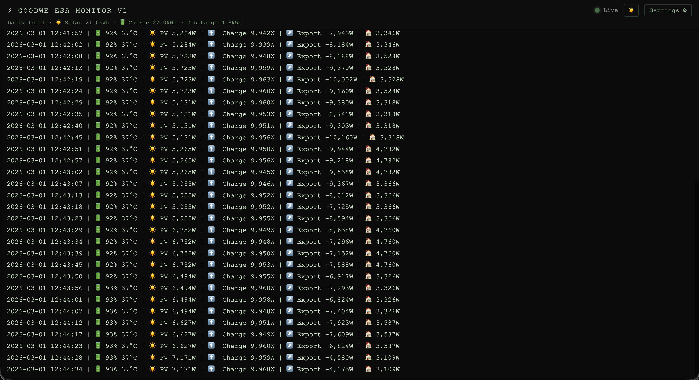
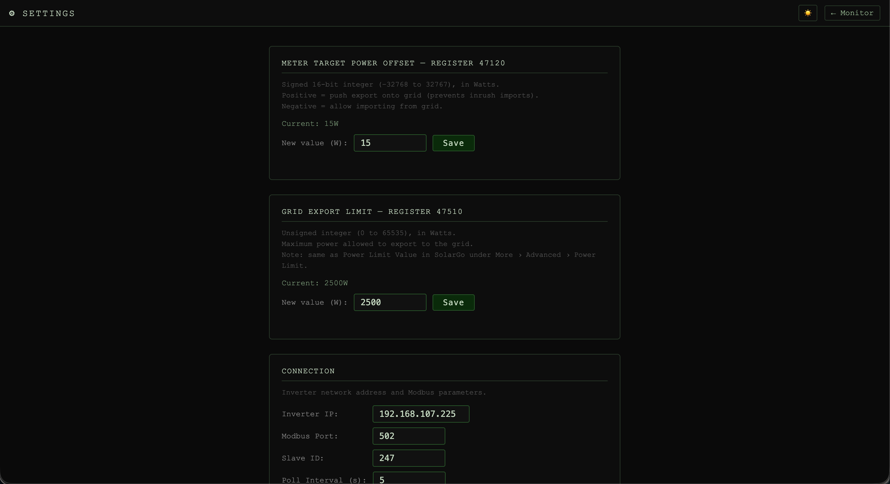
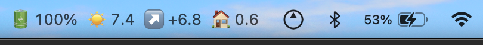
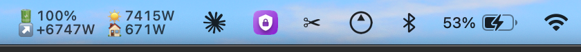

# GoodWe ESA Monitor

A live web monitor for GoodWe ESA hybrid inverter/battery systems. Reads data via Modbus TCP and displays it in a real-time dashboard with WebSocket streaming. Includes a settings page for adjusting inverter registers, and a [macOS menu bar companion app](#macos-menu-bar-app).




---

## Quick start (pre-built image)

Use the `docker-compose.yml` in the repo root — paste it into Portainer or run it directly:

```bash
# Edit INVERTER_IP in docker-compose.yml if needed, then:
docker compose -f docker-compose.yml up -d
```

Open http://localhost:8765 in your browser.

---

## Development (build from source)

```bash
cd docker
docker compose -f docker-compose.dev.yml up -d --build
```

---

## Configuration

Set environment variables directly in the compose file (or via Portainer's Stack → Environment Variables UI):

| Variable | Default | Description |
|---|---|---|
| `INVERTER_IP` | `192.168.1.x` | IP address of your GoodWe inverter |
| `MODBUS_PORT` | `502` | Modbus TCP port |
| `SLAVE_ID` | `247` | Modbus slave ID |
| `TZ` | `Australia/Brisbane` | Timezone for timestamps (e.g. `Europe/London`, `America/New_York`) |
| `PORT` | `8765` | Host port to expose the web UI on |

Once running, connection details can also be changed via the Settings page — they are saved to `/data/inverter_config.json` inside the container and take precedence over environment variables on next startup.

---

## Portainer

Deploy as a Stack by pasting in `docker-compose.yml`. Set `INVERTER_IP` (and any other overrides) via the Stack → Environment Variables section — no `.env` file required.

---

## Settings UI

Visit http://localhost:8765/settings to:
- Change the inverter connection details (IP, port, slave ID)
- Read and write inverter registers (Meter Target Power Offset, Grid Export Limit)

---

## macOS menu bar app

`macos/` contains a native companion app (macOS 13 Ventura or later) that keeps the key figures in your menu bar: 🔋 battery SoC, ☀️ PV power, ↗️ grid export (+ exporting, − importing) and 🏠 house load.

Single row (kW):



2×2 grid (W, with units):



**How it works:** the app subscribes to this web app's `/ws` WebSocket stream — the same live feed the dashboard uses — rather than talking Modbus to the inverter. The dongle only accepts one TCP connection, so the web app stays the single point of contact and the menu bar app also reflects its pause state. Values grey out if no update arrives for 60 seconds, and the app reconnects automatically after sleep or a server restart. Clicking it shows the full readings, last update time, and links to the dashboard and settings.

**Build and install** (needs Xcode or the Command Line Tools):

```bash
macos/build_app.sh
cp -R "macos/build/GoodWe Monitor.app" /Applications/
```

On first launch the Settings window opens. Enter the host running the web app (port 8765 by default), then choose:
- a single-row or 2×2 grid layout
- kW (one decimal place) or W
- whether to show icons and unit labels
- launch at login

---

## Updating (reminder for the developer!)

After making code changes:

```bash
docker buildx build --platform linux/amd64,linux/arm64 -t dancet/goodwe-esa-monitor:latest . --push
```

For a local dev rebuild without pushing:
```bash
docker compose -f docker-compose.dev.yml up -d --build
```

Saved config lives in the named Docker volume and is preserved across rebuilds.
